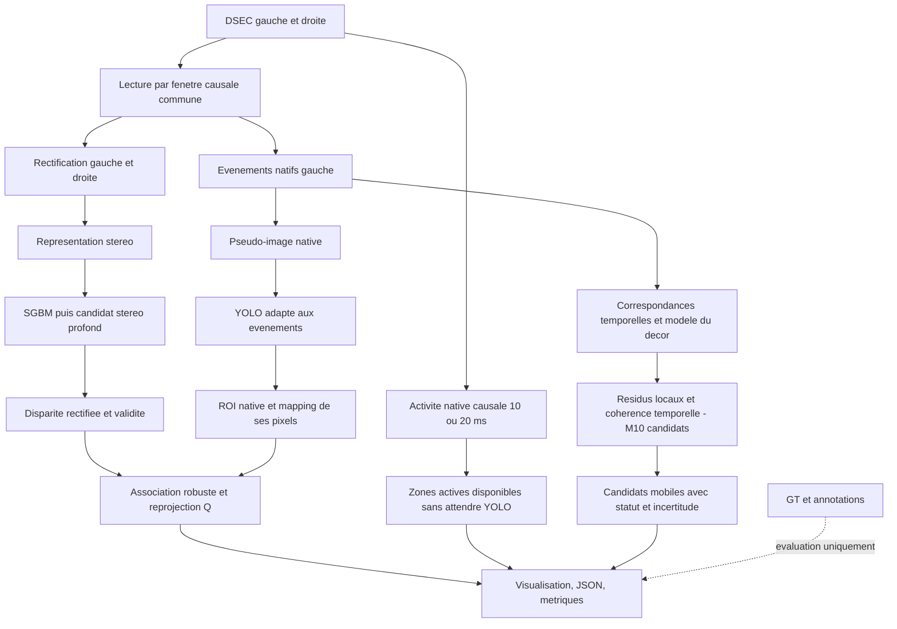

# Architecture proposée et contrats

## Architecture exécutée au 18 octobre 2026

Le parcours maintenu est `scripts/run_integrated_demo.py` : lecture DSEC causale → représentations → historique exact (stéréo historique recalculée si absente), suivi sur 100 ms et modèle rigide → publication des indices dans `motion.jsonl` → SGBM courant et mémorisation → YOLO11n et association XYZ aux dates de contexte → GIF et JSON. `clip_motion.py` et `object_surface.py` partagent les calculs de mouvement et de surface. La profondeur de mouvement date de t−100 ms ; celle associée à une nouvelle détection date de t. Le cache ne substitue jamais une date voisine. La stéréo courante ne bloque plus la publication du mouvement de la même date ; elle reste exécutée avant le traitement de la date suivante.

Après choix explicite de l'utilisateur, le mouvement est prioritaire : pas source 20 ms pour ses indices, contexte YOLO/XYZ toutes les 100 ms de temps dataset (défaut, non ajusté sur les résultats). Le contrôle `--context-step-ms 20` calcule le contexte à chaque date. La stéréo interne conserve toutes les dates nécessaires à la compensation. Chaque contexte porte date, âge et référence au fichier calculé ; les objets ne sont présents dans la ligne courante que si `context.updated` est vrai. Un contexte ancien n'est ni dessiné sur une nouvelle image, ni transformé dans la caméra actuelle. Âge dataset ≠ latence système.

Les images sont traitées dans l’ordre sur CPU, avec Y01 par défaut ou Y02 choisi explicitement. Depuis le 17 octobre, les appariements stéréo direct et inverse se chevauchent grâce à un worker persistant et deux matchers distincts ; la cohérence gauche/droite attend les deux résultats. Depuis le 18 octobre, le même worker prépare aussi l'image droite en parallèle de la gauche. Les indices sont écrits et le flux vidé avant le YOLO de la même date ; ce dernier peut cependant retarder la date suivante. La branche d’activité M01/M09 reste une expérience conservée, pas un détecteur fiable d’objets mobiles intégré à cette commande. La stéréo profonde, un ordonnanceur asynchrone indépendant et la persistance d’identités d’objets restent absents. [État, coût et suite](20_NEXT_STEPS.md).

**Conception et étapes historiques ci-dessous.** Les diagrammes cibles et anciennes « prochaines étapes » ne remplacent pas cet état.

## Priorité de mobilité — 7 octobre 2026

La branche rapide doit évoluer de l’activité vers des propositions d’objets mobiles : suivi temporel des structures, modèle du déplacement apparent du décor, résidus et cohérence temporelle, avec abstention en cas d’ambiguïté. M03 fournit la référence globale ; M10 ajoute des candidats cohérents et persistants, exécutés sur train mais sans validation du mouvement indépendant. YOLO pourra ajouter une classe et la stéréo une profondeur, sans décider seuls qu’un objet bouge. [Contrats et évaluation](38_OBJECTIF_OBJETS_MOBILES.md).

## Principe

Une application Python locale et des expériences GPU Colab. Priorité au 4 octobre 2026 : une branche d'activité native à fenêtres courtes, indépendante de YOLO et de la stéréo. Ces deux branches complètent ensuite le résultat par une classe et une profondeur. Leurs fenêtres et cadences peuvent différer ; leurs sorties gardent un timestamp et un âge explicites. Le diagramme décrit la cible ; M01 réalise déjà la branche d'activité, sans association sémantique ni compensation de caméra.

Les adaptations à la chaîne initiale du cahier des charges sont motivées : branches sémantique/géométrie indépendantes ; préservation des annotations natives ; chemin d'activité léger mis à jour plus souvent que les réseaux. La GT ne traverse jamais la branche d'inférence.

## Structure progressive

`src/pfe_events/` accueille les fonctions réutilisables, d'abord lecteur et représentations. Au fur et à mesure : `stereo.py`, `geometry.py`, `detection.py`, `fusion.py`, `motion.py`. Scinder un module uniquement lorsqu'il devient difficile à lire. `scripts/` fournit les commandes, `tests/` les cas à risque, `docs/` les notes. `data/raw` garde les originaux ; `data/processed` les exports reproductibles. `outputs/` contient rapports et visualisations. `models/` et `notebooks/` seront créés lors de leur première utilisation.

Cette organisation a moins de sous-dossiers que la suggestion initiale ; les fonctions restent localisables sans couches d'abstraction.

## Interfaces cibles

| Objet | Champs essentiels | Invariant |
|---|---|---|
| Fenêtre | `x,y,t_us,p,start_us,end_us,view` | Même unité temporelle, borne droite exclusive |
| Représentation | tenseur, ordre des canaux, normalisation, résolution, vue | Toute transformation est traçable |
| Disparité | `d_px`, masque valide, `timestamp_us`, calibration_id | Repère gauche rectifié, bonne unité |
| Détection | classe, score, `xyxy`, vue, temps | Coordonnées remises à l'échelle après letterbox |
| Objet 3D | point XYZ, repère, support, dispersion, statut | Pas de coordonnées si support insuffisant |
| Mesure | durée de chaque étape, mémoire, matériel, cadence | Distinguer temps dataset et temps horloge |

La stéréo peut retourner une carte partiellement invalide. Une absence de détection est un résultat valide. Un fichier absent ou une calibration incohérente est une erreur qui doit arrêter la commande ; elle ne doit pas devenir une carte de zéros silencieuse.

## Dépendances et environnements

Socle CPU installé : NumPy, h5py, hdf5plugin, PyYAML, Pillow et OpenCV headless pour S01. `stereo.py`, `geometry.py`, `representations.py`, `dsec.py` et `pilot.py` sont présents. DL : PyTorch + Ultralytics, à installer dans un environnement GPU séparé. L'environnement de lecture Python 3.14 ne prouve pas la compatibilité des anciens dépôts scientifiques ; ne pas y installer arbitrairement leur pile CUDA. Choisir le runtime Colab et verrouiller les versions après un premier test d'inférence.

## Démonstrateur final

Panneaux : événements gauche/droite, boîtes dans la vue native, disparité prédite avec masque, tableau XYZ/statut et performances. Marquer clairement `GT — diagnostic` si une carte de référence est affichée. En lecture d'une prédiction précalculée, afficher `REJEU DE PRÉDICTIONS`. Pas d'interface web complexe requise : fenêtre OpenCV ou vidéo annotée plus panneau de mesures conviennent.

## État de la branche objets mobiles après M10

Le filtre de cohérence et de persistance est maintenant exécuté sur train, en aval des correspondances et du modèle global M03. Il utilise le lecteur M08 et retourne des candidats explicitement incertains. La profondeur, la pose et YOLO n'entrent pas encore dans cette décision. La compensation géométrique et la référence de mobilité restent à construire : la parallaxe et la rotation locale exposent des limites observées. [Bilan M10](39_M10_MOBILE_CANDIDATES.md).

## M11 : géométrie implémentée, intégration réelle en préparation

La branche géométrique dispose d'un estimateur robuste du modèle rigide dominant à partir de points rectifiés suivis et de leur profondeur au premier instant. Il fournit résidus et abstention, sans dépendre d'une boîte YOLO. Les tests M11 utilisent une profondeur synthétique de référence explicitement oracle ; aucun résultat réel de mouvement indépendant n'est encore validé. Le raccord aux profondeurs S01 prédites et aux correspondances rectifiées reste la prochaine étape. [Bilan M11](40_M11_RIGID_MOTION.md).

## M12 : raccord aux données réelles exécuté

Événements gauches → splat rectifié/normalisation S01 → correspondances LK → profondeur prédite S01 aux points précédents → modèle rigide M11 → résidus/abstention. Ce chemin est exécuté sur 38 paires train, sans pose ou profondeur GT. Il ne comporte pas encore de persistance continue, de regroupement en objets ni de validation réelle de mobilité. Les cadences asynchrones restent une cible : ce diagnostic avec profondeur en cache coûte 321–385 ms médians par paire. [Preuves M12](41_M12_REAL_RIGID_MOTION.md).
