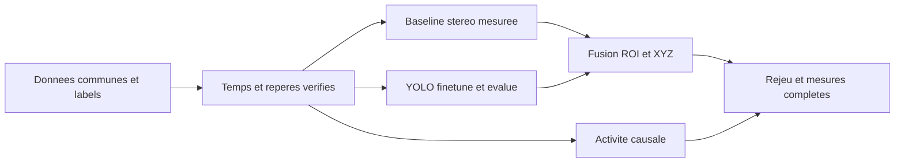

# Plan de réalisation — 12 à 16 semaines

**Réorientation demandée le 4 octobre 2026 :** la branche de détection rapide du mouvement passe avant l'allongement de l'entraînement YOLO. M01 fournit une première activité causale ; la prochaine porte est le délai mesuré, avec contrôle du mouvement de caméra. Le tableau ci-dessous conserve le calendrier initial, mais l'activité et son évaluation sont avancées dès maintenant. [Priorités actuelles](20_NEXT_STEPS.md).

Départ de référence : 3 octobre 2026. Douze semaines mènent au 26 décembre 2026 ; seize semaines au 23 janvier 2027. Ce sont des jalons de planification, pas une échéance de soutenance déclarée par l'utilisateur. Hypothèse de capacité : 15–20 heures de travail technique par semaine, à adapter ; aucune disponibilité personnelle n'est présumée confirmée.

| Semaines | Travail et livrable vérifiable | Porte de sortie / repli |
|---|---|---|
| 1–2 | Audit, sources, manifeste, lecteur, visualisation, tests temps/calibration | Au moins une paire réelle et sa GT inspectées ; sélectionner séquences et classes |
| 3–4 | Représentations et baseline stéréo ; métriques avec masques | Première profondeur **prédite**, couverture et erreurs ; si échec, diagnostiquer rectification/temps avant DL |
| 5–6 | Export labels, pilote puis fine-tuning YOLO Colab ; audit checkpoint stéréo dans budget court | YOLO réellement adapté et évalué par classe ; checkpoint profond exécutable ou repli justifié |
| 7–8 | Fusion robuste et XYZ, indicateur activité, premier rejeu intégré | MVP bout en bout ; aucune substitution de GT dans l'inférence |
| 9–10 | Comparaison stéréo profonde/baseline, fenêtre/latence et fusion | Petit nombre d'expériences reproductibles et conclusion appuyée par mesures |
| 11–12 | Démonstrateur, cas d'échec, test figé et nettoyage | Livrable fonctionnel, tests et documentation synchronisés |
| 13–14, marge | Répétitions, correction fragilités, éventuellement MVSEC | Améliorer la confiance sans nouvelle architecture lourde |
| 15–16, marge | Répétition démo et audit de reprise sur environnement propre | Archive des dépendances/poids/configs, limites et guide de présentation technique |

Les phases 0–16 du cahier des charges sont conservées conceptuellement mais regroupées : les tests, documentation et mesures accompagnent chaque phase plutôt que d'attendre la fin. La détection est préparée tôt car l'accès aux labels est aussi critique que la profondeur.

## Chemin critique MVP

L'accès à un GPU Colab devient nécessaire lors du pilote YOLO. Le téléchargement complet du dataset, l'entraînement stéréo depuis zéro, le tracking avancé et une interface web ne sont pas sur ce chemin.

## Contribution défendable

Contribution principale actualisée : réponse événementielle rapide, causale et indépendante des classes, avec mesure du compromis délai/fausses alertes et prise en compte du mouvement de caméra. YOLO et la fusion robuste avec profondeur rectifiée enrichissent ensuite les zones par une classe et un point de surface 3D, avec abstention. F01 conserve la comparaison de fusion. L'intégration et l'évaluation sont une valeur d'ingénierie ; aucune nouveauté algorithmique mondiale n'est revendiquée.

## Limites de temps pour éviter l'enlisement

- Choix des données : deux semaines maximum avant figer le premier sous-ensemble.
- Installation d'un modèle stéréo : deux journées actives/candidat, deux candidats maximum.
- Surapprentissage d'un petit lot YOLO : s'il échoue, arrêter l'entraînement long et corriger le pipeline.
- Fin semaine 8 : si le MVP manque, reporter MVSEC, voxel comparatif et tracking, conserver les MUST.
- À chaque échec : consigner méthode, motif, diagnostic, alternative et impact sur les métriques.

Les résultats du premier échantillon ne permettent pas encore d'estimer le nombre d'heures d'entraînement ni de promettre le temps réel sur le CPU local.
