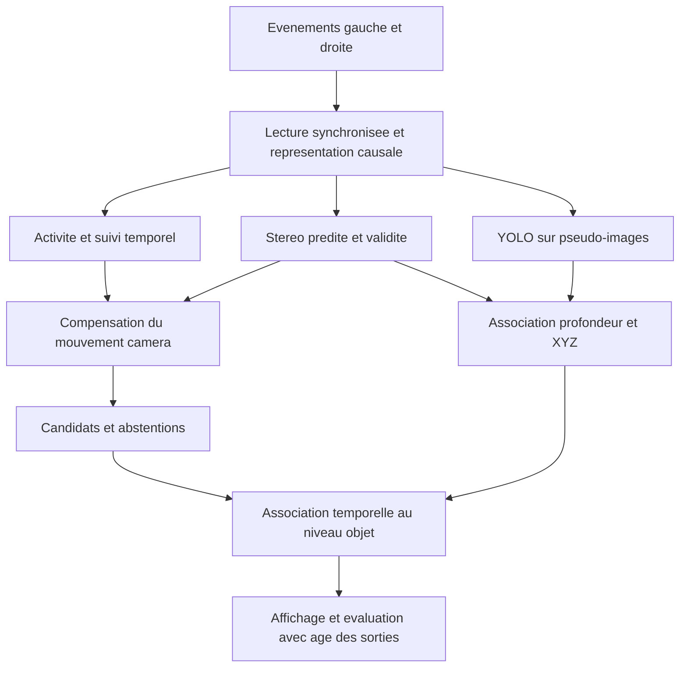

# Conception technique — Stéréovision événementielle et détection des objets mobiles

Version 2.0 corrigée — 10 octobre 2026 — revue documentaire D01.

Ce document révise le fichier externe `conception_pfe_stereo_evenementielle (1).md`. Il décrit les acquis et les développements proposés à partir de M17. Il complète le [cahier des charges](PROJECT_BRIEF.md), les [décisions](DECISIONS.md) et les [prochaines étapes](20_NEXT_STEPS.md). Il ne remplace pas les consignes du projet et ne constitue pas un chapitre de mémoire.

[Veille corrigée](veille_bibliographique_pfe.md) · [Journal des corrections et limites de vérification](48_REVIEW_CONCEPTION_BIBLIOGRAPHIE.md).

## 1. Objectif et vocabulaire

Le pipeline doit exploiter deux flux événementiels pour détecter des objets mobiles malgré le déplacement de la caméra, reconnaître des objets avec YOLO et leur associer, lorsque les données le permettent, une position 3D dans un repère explicite. La composante Deep Learning et YOLO sont obligatoires ; un nouveau réseau stéréo entraîné depuis zéro ne l'est pas.

Question expérimentale : **dans des conditions et avec des références identiques, quel apport la profondeur stéréo prédite offre-t-elle à la séparation entre mouvement propre des objets et mouvement apparent du décor, et à quel coût temporel ?** Une absence d'amélioration doit aussi être rapportée.

Il faut distinguer :

- **Activité événementielle** : variations de luminosité, dues notamment au mouvement, à l'éclairage ou au bruit.
- **Détection sémantique** : reconnaissance d'une personne, voiture ou autre classe. Une voiture peut être stationnée.
- **Mouvement apparent** : déplacement mesuré dans l'image, qui dépend aussi du mouvement de la caméra et de la profondeur.
- **Candidat résiduel** : observation mal expliquée par un modèle de mouvement dominant ; erreurs de suivi, profondeur et calibration peuvent aussi produire ce résidu.
- **Mobilité indépendante** : mouvement de l'objet par rapport à un environnement de référence, à évaluer avec des annotations adaptées.
- **Inconnu** : support insuffisant ou estimation invalide. Il ne signifie pas immobile.

La résolution temporelle du capteur ne donne pas la latence du pipeline. Les événements n'ont pas l'intégration d'une exposition classique, mais leur accumulation en pseudo-images peut étaler les contours. Deux caméras ne garantissent pas une profondeur valide partout.

## 2. Point de départ réel

| Composant | Acquis au 10 octobre 2026 | Limite pertinente |
|---|---|---|
| Données et géométrie | Lecture DSEC, fenêtres causales, rectification, calibration, partitions par trajet | Respecter les repères natifs et rectifiés, ainsi que les timestamps propres à chaque sortie |
| S01 | Stéréo SGBM et profondeur prédite, 60 fenêtres évaluées | Sur la petite validation : erreur conditionnelle 1,045 px, couverture GT 36 % ; pas un score du benchmark officiel |
| Y01 | YOLO11n adapté aux pseudo-images événementielles, pilote Colab exécuté | mAP50 de validation 23,73 % après cinq époques ; diagnostic de mémorisation distinct du pilote |
| M01–M09 | Activité causale et optimisations vérifiées | Activité seule, cadence soutenue non garantie |
| M11–M12 | Compensation rigide avec profondeur, contrôles synthétiques et diagnostics réels | Le consensus dominant n'est pas une pose caméra certifiée |
| M15–M16 | Référence publique MOD ; six dates train appariées, 22 boîtes | Alignement vérifié seulement pour ces dates ; parallaxe RGB/événements résiduelle |
| M17 | Quatre paires traitables, profondeur fraîche, aucun résidu supérieur à 3 px | 7 boîtes sans historique, 4 sans suivi, 3 sans profondeur, 8 avec points évalués sans candidat |
| Fusion finale | Composants séparés disponibles | Association YOLO–profondeur–XYZ et décision objet intégrée restent à développer |

Preuves : [S01](21_STEREO_BASELINE.md), [Y01](24_Y01_COLAB_RESULTS.md), [M16](46_M16_DSEC_MOD_ALIGNMENT.md), [M17](47_M17_REFERENCE_DIAGNOSTIC.md). Les comptes M17 portent sur des boîtes à des dates, pas sur des identités indépendantes ; ils ne sont pas une mesure de rappel objet.

## 3. Données et séparation des usages

**DSEC reste principal.** Ses événements, calibrations et références de disparité sont complétés par des annotations distinctes selon la tâche :

| Ressource | Usage dans le PFE | Conditions |
|---|---|---|
| DSEC / disparité | Géométrie, stéréo, comparaison des profondeurs prédites | Même vue rectifiée, unités, dates et masque GT ; aucune GT injectée dans l'inférence annoncée comme prédite |
| DSEC-Detection | Entraînement et évaluation YOLO | Annotations sémantiques, pas labels de mobilité ; vérifier la transformation vers la profondeur rectifiée |
| DSEC-MOD | Référence publique de boîtes mobiles | Audit de l'alignement et de la couverture ; les boîtes ne donnent pas un masque pixel exact |
| DSEC-MOS | Candidat pour une future évaluation/apprentissage de segmentation | Masques publics à auditer avant usage local ; ne pas les confondre avec le paquet MOD déjà acquis |
| EVIMO2 | Complément pour les poses, la géométrie et la mobilité | M14 n'a acquis qu'une caméra ; conventions de calibration et définition de mobilité non résolues |
| M3ED, MVSEC, MTevent | Extensions possibles | Choisir la tâche selon la GT réellement disponible ; pas d'IoU mouvement promise sur tous ces jeux |

Les ressources publiques sont documentées dans la [veille corrigée](veille_bibliographique_pfe.md). Une même famille DSEC ne signifie pas que toutes ses annotations sont disponibles aux mêmes dates, dans les mêmes repères ou avec les mêmes partitions.

Pour l'état local : `zurich_city_04_b` et `04_e` servent au train/debug ; `thun_00_a` est une petite validation locale et n'est pas dans MOD. Le groupe `09` reste réservé : ne pas régler sur `09_e` en prétendant que `09_b` est indépendant. La provenance d'un checkpoint externe doit être examinée avant une conclusion sur un test réservé.

Les annotations restent dans l'évaluateur pour les diagnostics géométriques ; elles ne guident pas le modèle caméra. Pour un apprentissage supervisé, seuls les labels du train sont accessibles à l'entraînement. Les normalisations et hyperparamètres sont réglés hors test. Aucune annotation manuelle de l'utilisateur n'est requise.

## 4. Architecture cible et statut des branches



Le schéma est une cible d'intégration, pas la description d'un démonstrateur déjà terminé. Les branches ont des cadences explicites : l'activité peut continuer quand YOLO ou la stéréo sont indisponibles. Une compensation 3D qui a besoin de profondeur doit alors s'abstenir ou employer un repli clairement identifié. Réutiliser une carte ancienne sans contrôler sa date et sa géométrie n'est pas une solution valide.

Pour chaque résultat, conserver `sequence`, `timestamp_us`, fenêtre de support, repère, version du modèle, validité, source de profondeur, horodatage de disponibilité et âge des informations associées. Une valeur de confiance interne n'est pas une probabilité calibrée par défaut.

### 4.1 Représentations

Conserver la représentation logarithmique et le normaliseur S01 pour les comparaisons avec l'existant. Tester ensuite une représentation adaptée au checkpoint sélectionné. Un voxel grid à cinq bins est une variante, pas un choix universel déjà validé.

Définir explicitement le nombre de bins, le traitement des polarités, la normalisation temporelle, les unités, la résolution, les bornes des fenêtres et l'absence de données futures. Ne pas confondre le nombre de bins avec la baseline stéréo. Une time surface encode un historique avec décroissance ; elle n'est ni un flux optique ni nécessairement une fenêtre finie.

Une conversion en trois canaux pour YOLO doit respecter les canaux et la normalisation utilisés pendant son entraînement. Un réseau RGB préentraîné n'accepte pas directement des quadruplets `(x,y,t,p)`.

### 4.2 Stéréo : référence conservée et remplacement conditionnel

S01 reste la référence reproductible. La prochaine méthode apprise doit être sélectionnée après inspection du code, du checkpoint, des séquences d'entraînement, de la licence, des entrées et des ressources nécessaires sur Colab. Effectuer une inférence minimale avant tout nouvel apprentissage long.

MADNet-ε est une piste de faible coût : les auteurs annoncent plus de 140 FPS avec une représentation de 10 ms et un extracteur récurrent utilisant des cellules spiking ConvLSTM. Ce chiffre est celui de leur méthode ; il ne s'applique pas au pipeline complet du PFE ni à un réseau simplement « inspiré de MADNet ». Le matériel exact, le périmètre chronométré et les poids disponibles restent à auditer. [Notice institutionnelle](https://cris.unibo.it/handle/11585/1081390).

EMatch et Temporal Event Stereo sont des candidats documentés, sans engagement à reproduire les deux. Les [fiches bibliographiques](veille_bibliographique_pfe.md) distinguent leurs objectifs.

Corrections de conception :

- Un encodeur siamois partagé réduit les paramètres de l'encodeur par rapport à deux copies indépendantes. Il ne divise pas nécessairement le modèle entier par deux et ne garantit pas la cohérence géométrique gauche-droite.
- Un volume indexé par disparité n'implique pas automatiquement une agrégation par convolutions 3D. AANet cherche justement à remplacer ces convolutions coûteuses. [Article AANet](https://openaccess.thecvf.com/content_CVPR_2020/html/Xu_AANet_Adaptive_Aggregation_Network_for_Efficient_Stereo_Matching_CVPR_2020_paper.html).
- Le nombre de paramètres, seul, ne suffit pas à prédire le temps ou la VRAM. Résolution, plage de disparité, opérateurs et mémoire temporelle comptent aussi.
- Choisir la plage de disparité à partir de la calibration, des distances visées et du protocole. Ni 192 px ni une plage « plus petite pour EVIMO2 » ne constituent un choix démontré.
- Une sortie dense peut contenir des erreurs dans les zones sans support. Conserver un mécanisme de validité/abstention et mesurer la couverture utile.

### 4.3 Séparation objet/caméra

Conserver la baseline rigide de M11–M17 et ses diagnostics distincts : suivi validé, profondeur exploitable, modèle estimable, résidu. Un fond non plan peut créer de la parallaxe ; une similarité globale 2D ne suffit pas dans tous les cas.

Une éventuelle tête apprise pourra recevoir des représentations temporelles, la profondeur prédite, sa validité et son âge. Sa supériorité est une hypothèse à tester. Une profondeur seule, sans information temporelle ni hypothèse géométrique, ne donne pas la mobilité.

Avec MOD seul, ne pas convertir arbitrairement chaque rectangle entier en masque de l'objet. Une segmentation supervisée demande les masques MOS audités, ou un protocole de supervision faible déclaré comme tel. L'absence de label hors boîte ne certifie pas un fond statique exhaustif.

Une baseline classique constitue une comparaison, pas une garantie de réussite. Les résultats négatifs de M17 restent conservés.

### 4.4 XYZ et vitesse

Utiliser les matrices rectifiées et la reprojection `Q` du projet. Dans le cas rectifié standard avec conventions compatibles :

```text
d = u_gauche - u_droite
d_effective = d - (cx_gauche - cx_droite)
Z = fx * baseline / d_effective
X = (u - cx_gauche) * Z / fx
Y = (v - cy_gauche) * Z / fy
```

Si les points principaux horizontaux coïncident, la formule se réduit à `Z = fx * baseline / d`. Vérifier le signe de la baseline, les pixels, les mètres, les transformations de crop/redimensionnement et l'équivalence avec `Q`. Pour une autre configuration, employer la triangulation calibrée adaptée.

Associer une ROI transformée dans le bon repère à plusieurs profondeurs valides. Mesurer effectif, dispersion, profondeur de fond et occlusions ; une médiane peut encore sélectionner le fond. Une position représentative de surface n'est pas le centre 3D exact de l'objet, et une position XYZ n'est pas une boîte 3D complète.

La différence de deux positions dans deux repères caméra mobiles n'est pas une vitesse monde. Pour l'estimer, exprimer les positions dans un même repère avec une pose validée ; sinon annoncer uniquement une vitesse relative avec ses limites. Un filtre de Kalman ne résout ni les erreurs de repère ni les associations erronées.

## 5. Apprentissage : seulement après un essai reproductible

Ordre proposé : audit d'un checkpoint, inférence sur les dates de développement, mesure profondeur/couverture/coût, puis éventuel fine-tuning sur une partition DSEC définie. Une branche de segmentation constitue une expérience ultérieure, pas un préalable à M18. EVIMO2 n'est pas une étape obligatoire d'entraînement.

Si une nouvelle perte est nécessaire :

- Disparité : perte masquée et normalisée sur les GT valides ; traiter explicitement les lots sans GT. À chaque échelle, adapter les coordonnées et les valeurs de disparité ; ne pas interpoler les trous comme des mesures.
- Mouvement : BCE/Dice sont des options ; définir les pixels ignorés, les cas de masque vide et le déséquilibre. Séparer inconnus et négatifs.
- Pertes combinées : le poids dépend de leur normalisation et des gradients ; `lambda = 1` n'est qu'un point d'essai, pas un optimum.
- Inférence causale : passé seulement ; un enseignant utilisant du futur à l'entraînement doit être explicitement séparé du modèle évalué.
- Augmentations stéréo : un retournement horizontal naïf est invalide. Une transformation géométriquement cohérente exige la gestion des caméras, signes, disparités de référence et occlusions. Ne pas l'activer sans ces contrôles.

Le budget GPU dépend du modèle, des entrées et du batch ; 12–16 Go ne garantissent pas que tout entraînement proposé tienne en mémoire. Aucun téléchargement massif ou nouvelle dépendance n'est nécessaire pour cette revue.

## 6. Évaluation et comparaison équitable

| Tâche | Mesures à produire | Limites |
|---|---|---|
| Disparité | MAE, RMSE, erreurs >1 et >2 px sur GT ; couverture des prédictions | Rapporter erreur conditionnelle et abstentions ; le benchmark officiel évalue sur tous les pixels GT disponibles |
| YOLO | AP par classe, mAP50 et mAP50–95 | Ne mesure pas la mobilité ; contrôler labels, repères et partitions |
| Mobilité par boîtes | Précision/rappel/AP après une règle d'association définie | Des points résiduels dans des boîtes ne sont pas encore un détecteur objet évalué |
| Mobilité par masques | IoU/Dice sur domaine valide, couverture, erreurs par séquence | Référence de mobilité et masque d'évaluation requis ; traitement des inconnus déclaré |
| XYZ | Erreurs 3D si GT du même type et même repère | Profondeur de surface et centre d'objet sont des cibles différentes |
| Délai et fausses alertes | Délai après début de mouvement, événements manqués, alertes par durée | Débuts/arrêts et négatifs fiables nécessaires ; MOD/MOS seuls ne garantissent pas une vérité temporelle fine |

Les moyennes par pixel et par séquence ne sont pas interchangeables. Rapporter taille du corpus, dates, distribution des erreurs et cas d'échec. Le faible échantillon train de M17 sert au diagnostic, pas à une conclusion de généralisation.

Le [benchmark DSEC](https://dsec.ifi.uzh.ch/uzh/disparity-benchmark/) a un protocole différent d'une erreur locale calculée uniquement sur les pixels GT possédant une prédiction valide de S01. Les résultats de publications sur d'autres matériels ou modalités fournissent du contexte, pas une comparaison expérimentale directe.

### Ablations prioritaires

1. **M18 :** fenêtres de 50 ms/pas 20 ms contre 20 ms/pas 20 ms, sur les quatre dates communes de M17 ; mêmes seuils et normaliseur, profondeur recalculée. La quantité d'événements change aussi : ce n'est pas une mesure isolée de l'effet du chevauchement.
2. **Apport de la profondeur :** distinguer comparaison de systèmes (modèle 2D versus modèle rigide 3D) et véritable ablation d'entrée dans un même réseau. Une suppression de profondeur à l'inférence d'un réseau entraîné avec cette entrée crée un décalage de distribution ; entraîner les variantes sous un budget comparable si l'on veut conclure sur cette entrée.
3. **Stéréo S01 versus un modèle appris :** mêmes dates, suivi et critères ; rapporter tous les cas et un sous-ensemble de support commun. Une couverture supplémentaire peut changer les points utilisés pour estimer le modèle caméra.

Les variantes voxel/time surface, tailles de réseau et mémoire récurrente viennent ensuite si un diagnostic les motive. Le nombre de candidats seul ne sélectionne pas une meilleure méthode.

## 7. Temps, causalité et cadence

Pour une sortie datée `t`, une représentation causale utilise `[t-W, t)` avec un pas `S`. Les fenêtres se chevauchent si `W > S`. Cette convention doit être respectée des deux côtés.

Définir séparément :

- **Durée de support W** : historique utilisé. Après l'amorçage, une fenêtre glissante ne réattend pas nécessairement W avant chaque calcul.
- **Coût de service** : lecture, représentation, transfert, stéréo, suivi, compensation, YOLO et association selon les branches réellement utilisées.
- **Âge de sortie** : temps de disponibilité moins temps de référence, après mise en correspondance entre horloge du rejeu et timestamps des données.
- **Délai de détection** : disponibilité de la première décision valide moins début de mouvement de référence, avec incertitude sur ce début.

Le délai inclut l'attente de décision, les files de traitement et une éventuelle confirmation temporelle. `W + inférence + post-traitement` peut décrire un cas d'amorçage simplifié ; ce n'est pas une formule générale pour un système glissant ou à plusieurs cadences.

En traitement séquentiel, un pas de 10 ms exige un service moyen inférieur à 10 ms pour éviter une croissance durable du retard, avec une marge pour les pointes. Un modèle à 60 FPS ne garantit donc pas un pipeline à 100 sorties/s. En présence de files, de parallélisme ou d'images sautées, décrire l'ordonnancement, les limites et la politique de suppression.

Mesurer d'abord hors ligne chaque composant, puis un rejeu à cadence imposée sur des séquences assez longues. Rapporter médiane, p95, maximum, retard final, sorties manquées et mémoire. Pour GPU : échauffement, batch et précision documentés, synchronisation correcte ou événements CUDA ; distinguer calcul seul et transferts compris. Les nombres 100/1000 itérations sont des choix de protocole, pas une preuve de représentativité des scènes.

M17 mesure une médiane CPU de **654,8 ms sur quatre paires**, hors initialisation et rendu. Ce n'est ni une cadence soutenue ni un délai de détection. Les anciennes cibles « 60–100 FPS » restent des ambitions à reconsidérer après profilage, sans engagement de résultat.

## 8. Organisation et jalons réalisables

Conserver `src/pfe_events/`, `scripts/`, `configs/`, `tests/`, `notebooks/`, `data/`, `outputs/`, `docs/` et `markdowns/`. Le refactoring R01 est acquis. Le runtime CPU local et le runtime Colab d'entraînement ont des dépendances distinctes ; ne pas remplacer l'environnement pour suivre un exemple externe.

| Ordre | Jalon | Critère de sortie |
|---|---|---|
| 1 | Diagnostic temporel M18 | Comparaison figée, support et abstentions expliqués, aucun label inventé |
| 2 | Audit puis essai d'une stéréo apprise | Entrées/checkpoint traçables, inférence et coût mesurés ; S01 conservé |
| 3 | Décision de mobilité au niveau objet | Sortie et association définies ; protocole public adapté ; apprentissage éventuel limité |
| 4 | Intégration YOLO–profondeur–XYZ | Boîtes prédites, repère et âge explicites, abstention sur profondeur invalide |
| 5 | Rejeu et comparaison finale | Mesures de qualité autorisées par la GT, coûts, retard, limites et démonstrateur |

Ce sont des jalons techniques, pas un nouveau planning de vingt semaines ni une promesse de précision. Leur charge sera estimée après les essais courts ; le périmètre du cahier des charges est celui d'un étudiant avec 3–4 mois annoncés au départ. Éviter le cumul entraînement stéréo depuis zéro + nouveau réseau mouvement + plusieurs datasets + déploiement spécialisé.

## 9. Risques à suivre

| Risque | Réponse prévue |
|---|---|
| Activité, classe ou résidu assimilés à un mouvement propre | Conserver les états distincts et comparer à une référence adaptée |
| Points absents sur un petit objet | Diagnostiquer suivi et représentation avant tout réglage du seuil de résidu |
| Profondeur absente, fausse ou ancienne | Mesurer support/validité/âge, s'abstenir et conserver les erreurs |
| Modèle dominant absorbant des objets mobiles | Examiner la distribution des supports et les cas analytiques ; pas de pose « vraie » présumée |
| Label décalé, masque imprécis ou non exhaustif | Audit spatial/temporel et analyse de sensibilité ; aucune hiérarchie de qualité fondée sur le seul nom du capteur |
| Fuite entre partitions ou checkpoint déjà entraîné sur notre test | Traçabilité des groupes, poids et données ; qualification honnête de l'évaluation |
| Retour au début du projet | Réutiliser les modules testés et conserver les artefacts expérimentaux |

Après modification de ce document source, exécuter `python scripts/sync_markdowns.py`. Les consignes persistantes restent dans `AGENTS.md` ; aucun bloc d'instructions importé ne les remplace.
